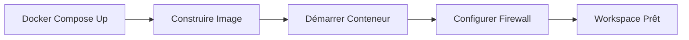
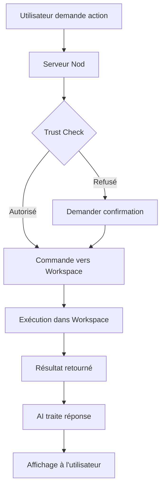

# Le Workspace Nod - Explication Détaillée

## 🎯 Qu'est-ce que le Workspace ?

Le **Workspace** est un **conteneur Docker isolé** qui sert d'environnement d'exécution sécurisé pour toutes les commandes et scripts que l'AI (Nod) exécute pour vous.

### Analogie Simple

Imaginez le Workspace comme une **machine virtuelle légère** où Nod peut :

- Exécuter des commandes shell
- Installer des packages
- Manipuler des fichiers
- Exécuter des scripts Python, Node.js, etc.

**SANS** risque pour votre système principal !

---

## 🏗️ Architecture du Workspace

```
┌─────────────────────────────────────────────────────────┐
│              Votre Machine (Host)                       │
│  ┌───────────────────────────────────────────────────┐ │
│  │            Conteneur Workspace                     │ │
│  │  (Linux Debian Bookworm Slim)                     │ │
│  │                                                     │ │
│  │  ┌──────────────────────────────────────────────┐ │ │
│  │  │  Système de Fichiers Isolé                   │ │ │
│  │  │  /workspace/  ← Dossier de travail           │ │ │
│  │  │  /home/node/  ← Home de l'utilisateur        │ │ │
│  │  └──────────────────────────────────────────────┘ │ │
│  │                                                     │ │
│  │  ┌──────────────────────────────────────────────┐ │ │
│  │  │  Outils Installés :                          │ │ │
│  │  │  • Python 3 + pip + venv                     │ │ │
│  │  │  • Node.js + npm                             │ │ │
│  │  │  • Git                                       │ │ │
│  │  │  • ffmpeg (vidéos/audio)                     │ │ │
│  │  │  • LibreOffice (sans GUI)                    │ │ │
│  │  │  • Tesseract OCR                             │ │ │
│  │  │  • ripgrep (recherche)                       │ │ │
│  │  │  • yt-dlp (téléchargement vidéos)           │ │ │
│  │  │  • RTK (outil Rust)                          │ │ │
│  │  │  • poppler (PDF)                             │ │ │
│  │  │  • qpdf, ghostscript                         │ │ │
│  │  │  • jq (JSON)                                 │ │ │
│  │  │  • sqlite3                                   │ │ │
│  │  └──────────────────────────────────────────────┘ │ │
│  │                                                     │ │
│  │  ┌──────────────────────────────────────────────┐ │ │
│  │  │  Utilisateurs :                              │ │ │
│  │  │  • node (UID 1000) - Principal               │ │ │
│  │  │  • nod-connected (UID 1002) - CLI isolés    │ │ │
│  │  └──────────────────────────────────────────────┘ │ │
│  │                                                     │ │
│  │  ┌──────────────────────────────────────────────┐ │ │
│  │  │  Firewall Réseau :                           │ │ │
│  │  │  ✅ Autorisé : Internet public               │ │ │
│  │  │  ❌ Bloqué : Réseau local (192.168.x.x)      │ │ │
│  │  │  ❌ Bloqué : localhost de l'host             │ │ │
│  │  └──────────────────────────────────────────────┘ │ │
│  └─────────────────────────────────────────────────────┘ │
│                         ▲                                │
│                         │ API                            │
│              ┌──────────┴──────────┐                    │
│              │   Serveur Nod       │                    │
│              │   (Node.js)         │                    │
│              └─────────────────────┘                    │
└─────────────────────────────────────────────────────────┘
```

---

## 🔐 Pourquoi un Workspace Isolé ?

### Sécurité Multi-Couches

1. **Isolation du Système**
   - Le Workspace ne peut **PAS** accéder directement à vos fichiers Windows
   - Vos données personnelles restent sur votre machine
   - Si une commande plante, seul le conteneur est affecté

2. **Isolation Réseau**
   - **Firewall intégré** bloque les adresses privées
   - Empêche l'accès à votre réseau local (192.168.x.x, 10.x.x.x)
   - Autorise uniquement les connexions publiques (ex: APIs, sites web)

3. **Pas de Clés API**
   - Vos clés OpenAI, Anthropic, etc. **NE SONT JAMAIS** dans le Workspace
   - Les appels API sont faits par le serveur Nod (sur l'host)
   - Le Workspace ne connaît jamais vos credentials

4. **Utilisateurs Séparés**
   - `node` : Utilisateur principal pour les commandes normales
   - `nod-connected` : Utilisateur séparé pour les CLI connectés (GitHub CLI, etc.)

---

## 🎯 À Quoi Sert le Workspace ?

### 1. Exécution de Commandes Shell

Quand vous demandez à Nod d'exécuter une commande, il la lance dans le Workspace :

```bash
# Vous : "Liste les fichiers Python dans mon projet"
# Nod exécute dans le Workspace :
ls *.py

# Vous : "Quel est l'usage disque ?"
# Nod exécute :
du -sh *
```

### 2. Manipulation de Fichiers

Le Workspace a un système de fichiers propre où Nod peut :

- Créer des fichiers temporaires
- Télécharger des ressources
- Traiter des documents
- Générer des rapports

```
/workspace/
├── temp/               # Fichiers temporaires
├── downloads/          # Téléchargements
└── output/            # Résultats générés
```

### 3. Exécution de Scripts

#### Python

```python
# Nod peut exécuter du Python dans le Workspace
python3 << EOF
import pandas as pd
df = pd.read_csv('data.csv')
print(df.describe())
EOF
```

#### Node.js

```javascript
// Ou du JavaScript/Node.js
node -e "console.log('Hello from workspace')"
```

### 4. Traitement de Données

Le Workspace est équipé pour traiter :

- **Vidéos** : ffmpeg, yt-dlp
- **Documents** : LibreOffice (conversion PDF, DOCX, etc.)
- **Images** : ImageMagick (si installé)
- **OCR** : Tesseract (extraction texte depuis images)
- **PDF** : poppler, qpdf, ghostscript

### 5. Intégration Git

```bash
# Cloner un repo
git clone https://github.com/user/repo.git

# Faire des commits
git add .
git commit -m "Update"
```

---

## 🧩 Skills : Qu'est-ce que c'est ?

### Définition

Les **Skills** dans Nod sont des **procédures sauvegardées** que l'AI peut apprendre et réutiliser. Ce sont comme des "recettes" de tâches complexes.

### Comment ça Marche ?

D'après `AGENTS.md`, les skills sont :

1. **Appris Automatiquement**
   - L'AI observe ce que vous lui demandez de faire
   - Si une tâche est répétée ou complexe, elle peut la sauvegarder
   - Via la commande `skills save` (interne à l'AI)

2. **Stockés en Base de Données**
   - Table `memory` dans PostgreSQL
   - Type : `learned skills`
   - Contiennent : Une procédure pas-à-pas

3. **Réutilisés Automatiquement**
   - Quand vous demandez une tâche similaire
   - L'AI peut retrouver et adapter un skill existant

### Exemple de Skills

#### Skill 1 : Analyser un CSV

```yaml
name: 'Analyse CSV avec Pandas'
description: 'Charger un CSV, afficher statistiques descriptives et graphiques'
steps:
  - Installer pandas si nécessaire
  - Lire le fichier CSV
  - Afficher df.info(), df.describe()
  - Générer un histogramme des colonnes numériques
  - Sauvegarder le rapport en Markdown
```

#### Skill 2 : Convertir Video en GIF

```yaml
name: 'Video vers GIF optimisé'
description: 'Convertir une vidéo en GIF optimisé avec ffmpeg'
steps:
  - Extraire les frames à 10fps
  - Réduire la résolution à 480p
  - Générer une palette de couleurs
  - Créer le GIF avec la palette
```

#### Skill 3 : Setup Projet React

```yaml
name: 'Créer projet React TypeScript'
description: 'Initialiser un projet React avec TypeScript, ESLint, Prettier'
steps:
  - npm create vite@latest . -- --template react-ts
  - npm install
  - Installer ESLint + Prettier
  - Créer .eslintrc.json et .prettierrc
  - Ajouter scripts dans package.json
```

---

## 📦 Peut-on Installer des Packages dans le Workspace ?

### ✅ OUI - Installation Dynamique

Le Workspace peut installer des packages à la volée :

#### Python

```bash
# Créer un environnement virtuel
python3 -m venv /workspace/venv
source /workspace/venv/bin/activate

# Installer des packages
pip install pandas numpy matplotlib scikit-learn
```

#### Node.js

```bash
# Dans le workspace
npm init -y
npm install axios cheerio puppeteer
```

#### Système (apt-get)

```bash
# Packages système Debian
sudo apt-get update
sudo apt-get install -y imagemagick
```

### ⚠️ Attention : Installation Temporaire

**IMPORTANT** : Les installations dans le Workspace sont **éphémères** !

- Si le conteneur Workspace est recréé (`docker compose down` puis `up`)
- Toutes les installations custom sont **perdues**
- Le Workspace revient à son état initial

### 💾 Pour des Installations Permanentes

Si vous voulez qu'un package soit **toujours disponible** :

#### Solution 1 : Modifier le Dockerfile

**Fichier** : `Dockerfile.workspace`

```dockerfile
# Ligne ~7 - Ajouter vos packages système
RUN apt-get update && apt-get install -y --no-install-recommends \
    # ... packages existants
    imagemagick \
    pandoc \
    graphviz \
    && rm -rf /var/lib/apt/lists/*
```

#### Solution 2 : Ajouter des Dépendances Python Permanentes

**Fichier** : `src/providers/docker/workspace-artifacts.in`

```txt
# Vos packages Python
pandas==2.1.0
numpy==1.24.0
scikit-learn==1.3.0
```

Puis régénérer `workspace-artifacts.txt` :

```bash
pip-compile workspace-artifacts.in --generate-hashes
```

#### Solution 3 : Script d'Initialisation

Créer un script qui s'exécute au démarrage du Workspace :

**Fichier** : `src/providers/docker/workspace-init.sh`

```bash
#!/bin/bash
# Installation automatique au démarrage

# Créer un venv persistant
if [ ! -d "/workspace/.venv" ]; then
    python3 -m venv /workspace/.venv
    source /workspace/.venv/bin/activate
    pip install pandas numpy matplotlib
fi
```

Puis modifier `Dockerfile.workspace` pour l'exécuter.

---

## 🔄 Cycle de Vie du Workspace

### Démarrage



### Utilisation



### Arrêt

```bash
# Arrêter proprement
docker compose stop

# Supprimer complètement (perte des données temporaires)
docker compose down

# Reconstruire (après modification du Dockerfile)
docker compose up -d --build
```

---

## 🛠️ Commandes Utiles pour le Workspace

### Voir les Logs du Workspace

```powershell
# Logs en temps réel
docker compose logs -f workspace

# Dernières 100 lignes
docker compose logs --tail=100 workspace
```

### Entrer dans le Workspace (Debug)

```powershell
# Shell interactif dans le workspace
docker compose exec workspace bash

# En tant qu'utilisateur node
docker compose exec -u node workspace bash

# Explorer le système de fichiers
ls /workspace/
ls /home/node/
```

### Voir l'État du Workspace

```powershell
# État général
docker compose ps

# Détails du conteneur
docker inspect nod-local-workspace-1

# Utilisation ressources
docker stats nod-local-workspace-1
```

### Copier des Fichiers

```powershell
# Host → Workspace
docker cp mon-fichier.txt nod-local-workspace-1:/workspace/

# Workspace → Host
docker cp nod-local-workspace-1:/workspace/resultat.txt ./
```

---

## 🎓 Cas d'Usage Avancés

### 1. Analyse de Données

```
Vous: "Analyse ce fichier CSV et crée des graphiques"

Nod va:
1. Sauvegarder le CSV dans /workspace/
2. Installer pandas, matplotlib (si nécessaire)
3. Exécuter un script Python d'analyse
4. Générer des graphiques en PNG
5. Vous les montrer
```

### 2. Conversion de Documents

```
Vous: "Convertis ce PDF en DOCX"

Nod va:
1. Copier le PDF dans /workspace/
2. Utiliser LibreOffice: libreoffice --headless --convert-to docx
3. Récupérer le DOCX généré
4. Vous le proposer en téléchargement
```

### 3. Web Scraping

```
Vous: "Récupère les prix sur ce site e-commerce"

Nod va:
1. Installer beautifulsoup4, requests
2. Exécuter un script Python de scraping
3. Parser le HTML
4. Formater les résultats en tableau
5. Vous les présenter
```

### 4. Traitement Vidéo

```
Vous: "Extrais les 10 premières secondes de cette vidéo"

Nod va:
1. Télécharger la vidéo (yt-dlp ou URL)
2. Utiliser ffmpeg: ffmpeg -i video.mp4 -t 10 -c copy output.mp4
3. Compresser si nécessaire
4. Vous donner le fichier
```

---

## 🔒 Limites de Sécurité du Workspace

### Ce que le Workspace NE PEUT PAS Faire

❌ Accéder à vos fichiers Windows directement
❌ Voir vos mots de passe ou clés API
❌ Se connecter à votre réseau local (192.168.x.x)
❌ Accéder à localhost de votre machine
❌ Modifier vos paramètres système Windows
❌ Installer des drivers sur votre PC
❌ Accéder à vos autres conteneurs Docker

### Ce que le Workspace PEUT Faire

✅ Exécuter des commandes shell sécurisées
✅ Manipuler des fichiers dans son propre espace
✅ Se connecter à Internet public (APIs, sites web)
✅ Installer des packages dans son environnement
✅ Cloner des repos Git publics
✅ Traiter des documents, vidéos, images
✅ Exécuter du code Python, Node.js, etc.

---

## 📚 Résumé

| Aspect          | Description                                          |
| --------------- | ---------------------------------------------------- |
| **Type**        | Conteneur Docker Linux (Debian Bookworm)             |
| **Rôle**        | Environnement d'exécution isolé et sécurisé          |
| **Outils**      | Python, Node.js, Git, ffmpeg, LibreOffice, OCR, etc. |
| **Sécurité**    | Firewall, isolation réseau, pas de credentials       |
| **Persistance** | Éphémère (recréé à chaque docker compose down)       |
| **Skills**      | Procédures apprises et sauvegardées en DB            |
| **Extensions**  | Possibles via modification du Dockerfile             |

---

## 🎯 Prochaines Étapes

1. **Une fois Nod démarré**, testez des commandes dans le Workspace
2. **Observez** quels skills l'AI apprend naturellement
3. **Personnalisez** le Dockerfile si vous avez des besoins spécifiques
4. **Explorez** les capacités de traitement de données

---

**Questions fréquentes** : Voir aussi `AGENTS.md` (sections "Architecture", "Safety invariants")
